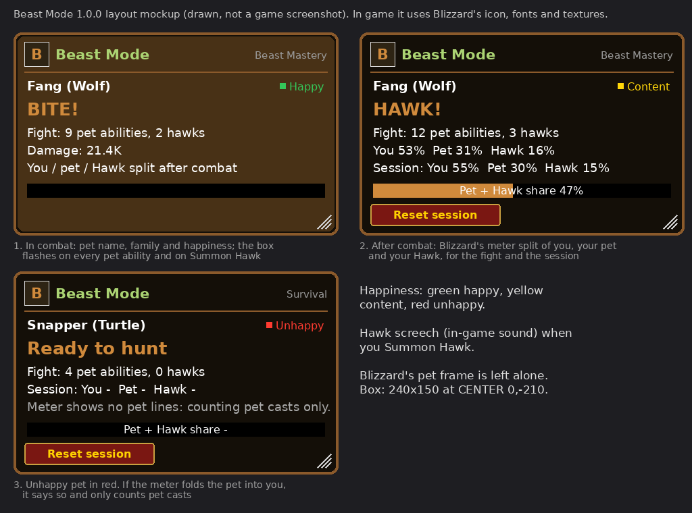

# Beast Mode (WoW: Forever) v1.0.0

  

A pet and Hawk box for Hunters. A small green-and-leather box shows your pet's name, family and happiness, and flashes every time your pet uses an ability or you call a Hawk. When the fight ends it shows how your damage split between **you, your pet and your Hawk**, taken from the game's own damage meter.

## What it shows
- **Your pet:** name and family, with a happiness dot: green happy, yellow content, red unhappy.
- **Live:** the box flashes with the ability's name (`BITE!`, `CLAW!`) on each pet ability, and `HAWK!` when you Summon Hawk, with a count for the fight.
- **After combat:** your share, your pet's share and your Hawk's share of the damage, for the fight and the session. The **Reset session** button starts a new session (it hides during combat).
- **Share bar:** pet plus Hawk share of your damage.

Blizzard's pet frame stays exactly where it is; Beast Mode does not replace or move it.

## Where the numbers come from
WoW: Forever runs on the modern client, which gives addons **no combat log**, and every single hit's damage reaches addons as a hidden ("secret") value. Beast Mode never guesses a number:
- **Pet abilities and Hawks** are exact: the game tells addons when your pet casts and when you cast Summon Hawk.
- **The split** comes from **Blizzard's built-in damage meter**, worked out once combat ends. The meter tags damage done by a pet or helper with that creature's name: lines from your pet's name count as pet, Summon Hawk and any other helper count as Hawk, and the rest is you.
- If the meter folds your pet into you (no pet lines), the box says **"counting pet casts only"**. `/bmode meter` lists the meter's lines for your last fight and who each one counted for.
- No live per-hit numbers and no live split: the game does not give single hits to addons.

Turn on the game's meter if the box shows no damage: **Options > Gameplay > Advanced > Damage Meter > Enable Damage Meter**.

## Sound
`/bmode sound hawk` (default): a hawk screech when you Summon Hawk. `/bmode sound every`: also on every pet ability. `/bmode sound off`.
`/bmode soundfile theme|screech|owl|dragonhawk` picks the sound and plays it once. All sounds are built into the game.

## Download
- **CurseForge:** https://www.curseforge.com/wow/addons/beast-mode. Author: [MasterRed92](https://www.curseforge.com/members/masterred92/projects).
- **Wago Addons:** https://addons.wago.io/addons/beastmode.
- **GitHub:** [Releases](https://github.com/masterred92/BeastMode/releases) · [Issues](https://github.com/masterred92/BeastMode/issues)
- **More by Kenny:** [GaleCount](https://github.com/masterred92/GaleCount) · [ReckoningCheckoning](https://github.com/masterred92/ReckoningCheckoning) · [ShadowCount](https://github.com/masterred92/ShadowCount) · [GoldPerSpot](https://github.com/masterred92/GoldPerSpot) · [MatTooltip](https://github.com/masterred92/MatTooltip) · [PriceLog](https://github.com/masterred92/PriceLog) · [NeutralFlip](https://github.com/masterred92/NeutralFlip)

## Commands
Main command `/bmode`; `/beastmode` works too.
`/bmode show` / `hide` · `lock` / `unlock` · `resetpos` · `scale 0.5-2` · `size <width> <height>` · `reset` (session) · `test` (preview out of combat) · `sound …` · `soundfile …` · `theme` (re-check your talents) · `meter` · `debug` · `report`

The box only appears on a Hunter. Move it by dragging; resize it with the corner grip. Both stop working while it is locked.

## Install
1. Download the zip, or clone this repo into a folder named `BeastMode`.
2. Put the `BeastMode` folder in `World of Warcraft\_forever_\Interface\AddOns\` (the folder next to `_retail_`; the exact name may differ).
3. Restart the game or type `/reload`, and check Beast Mode is ticked in the AddOns list.

## In-game test checklist
1. On a Hunter, the box appears below the middle of the screen, can be dragged and resized, and keeps its place after `/reload`. On other classes it stays hidden.
2. Call your pet: its name, family and happiness dot appear. Dismiss it: "No pet out". Let it get hungry: the dot turns yellow, then red.
3. Fight a mob: the box flashes the ability name on each pet ability. Summon Hawk: `HAWK!` and a screech.
4. After the fight: you / pet / Hawk shares appear, or "counting pet casts only". `/bmode meter` lists the meter lines.
5. **Reset session** sets the session line back to 0 and is hidden in combat.
6. No Lua errors and no "action blocked" messages during combat.

## Licence
MIT. Written from scratch; no code copied from other addons.
